<p align="center">
  
</p>

<h1 align="center">OpenFadeR-Themes</h1>

<p align="center">
  
</p>

<p align="center">
  <a href="LICENSE"></a>
</p>

Themes for [OpenFadeR](https://github.com/OpenRsG/OpenFadeR), the open-source DJ app. One JSON file restyles the whole window, colours to fonts to layout, and it applies while the app runs. The app has two themes built in (Catppuccin Mocha and Latte); this repository holds eleven more.

<p align="center">
  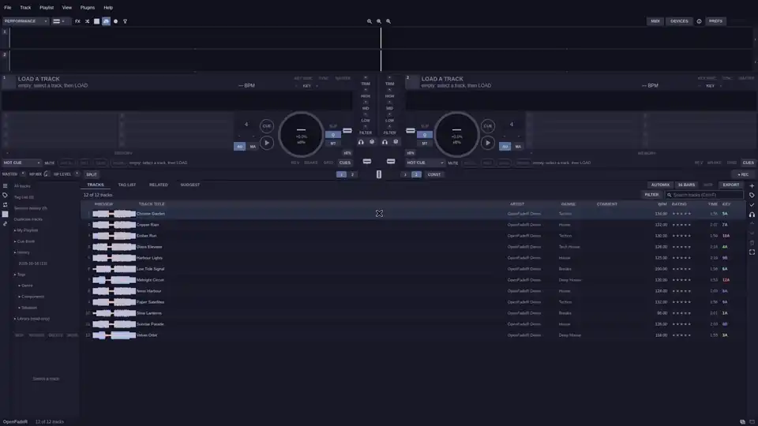
</p>

## Install in one click

In OpenFadeR open PREFERENCES > THEMES. The GET THEMES section lists every theme in this repository, painted in its own colours (this repository is in the list on first run). Press INSTALL, then APPLY.

<p align="center">
  
</p>

Prefer files? Copy the `.json` files you want into `~/.config/openfader/extension/skin/`, drop one on the app window, or point the app at a checkout:

```sh
OPENFADER_SKINS=/path/to/OpenFadeR-Themes openfader
```

The app watches these folders. Edit a theme file in a text editor and the window restyles within a second.

## The themes

Every picture is the same view: two decks playing in the drop of a demo track, with the track browser below.

### Catppuccin Mocha

The default, built into the app. The official dark palette mapped onto every surface, text, accent, waveform, meter and stem.

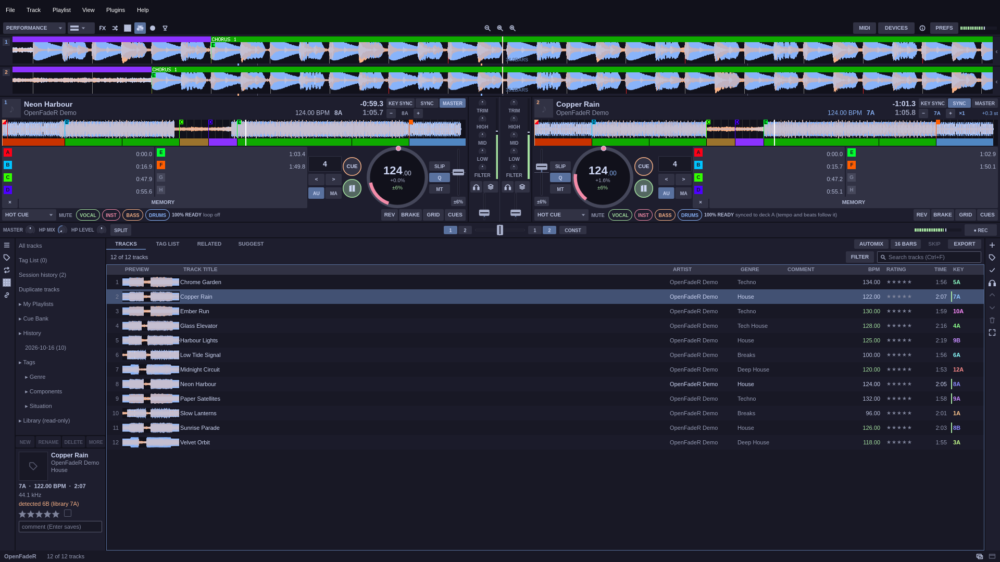

### Catppuccin Latte

Built in too: the light flavour of the same palette.

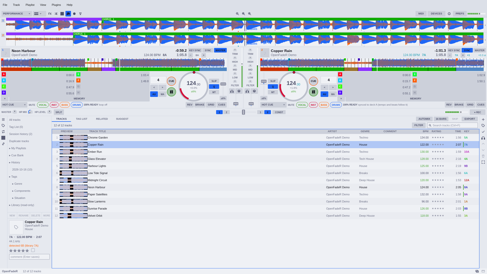

### Catppuccin Frappé and Macchiato

The two flavours between Latte and Mocha. Files: `catppuccin-frappe.json`, `catppuccin-macchiato.json`.


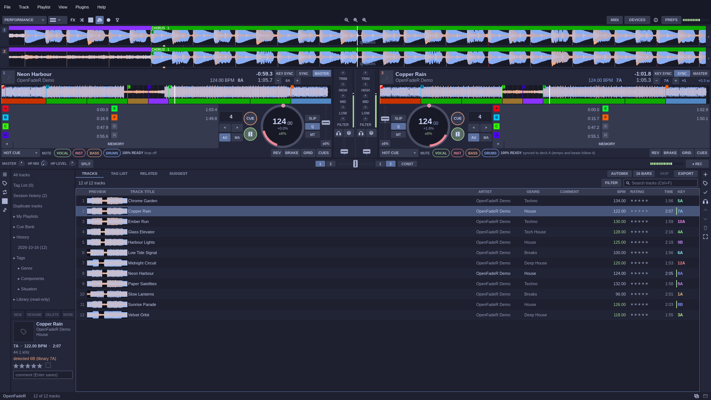

### Rek and Rek Light

Neutral greys with blue accents, green for play and amber for cues. Rek is near black; Rek Light is its light counterpart. Files: `rek.json`, `rek-light.json`.

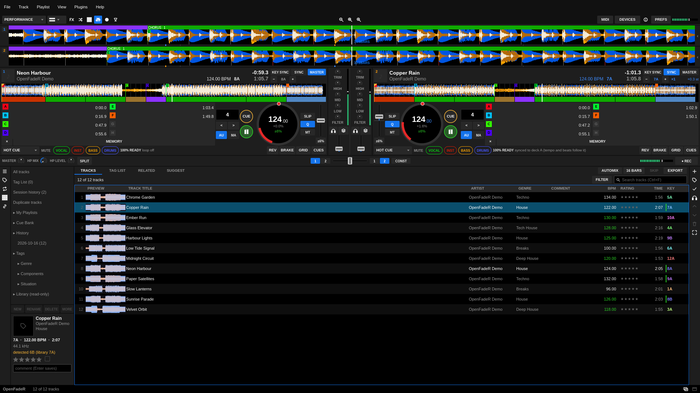

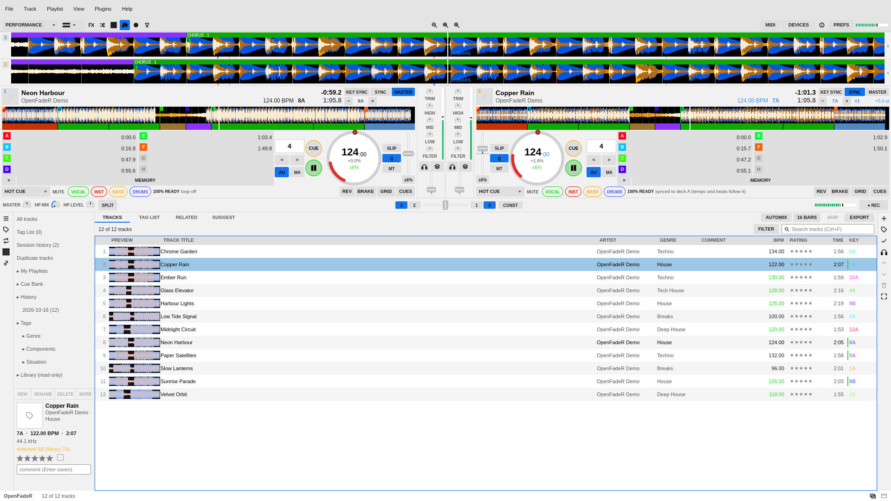

### So Pro

Near-black greys, a bright blue accent, a white platter and eight coloured pads in a 4 × 2 grid. It is the one theme that also asks for a layout: the vertical two-deck view, with the enlarged waveforms between the decks. File: `so-pro.json`.

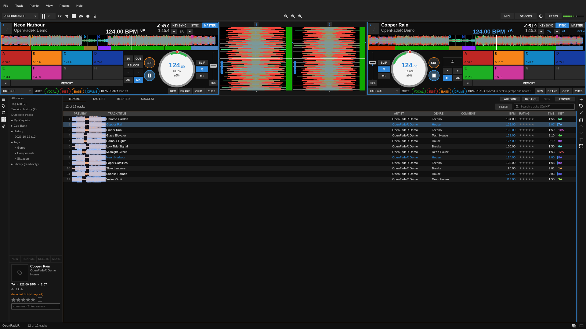

### Dracula

Vivid purple, pink and green on a dark blue-grey, after the Dracula palette by Zeno Rocha. File: `dracula.json`.

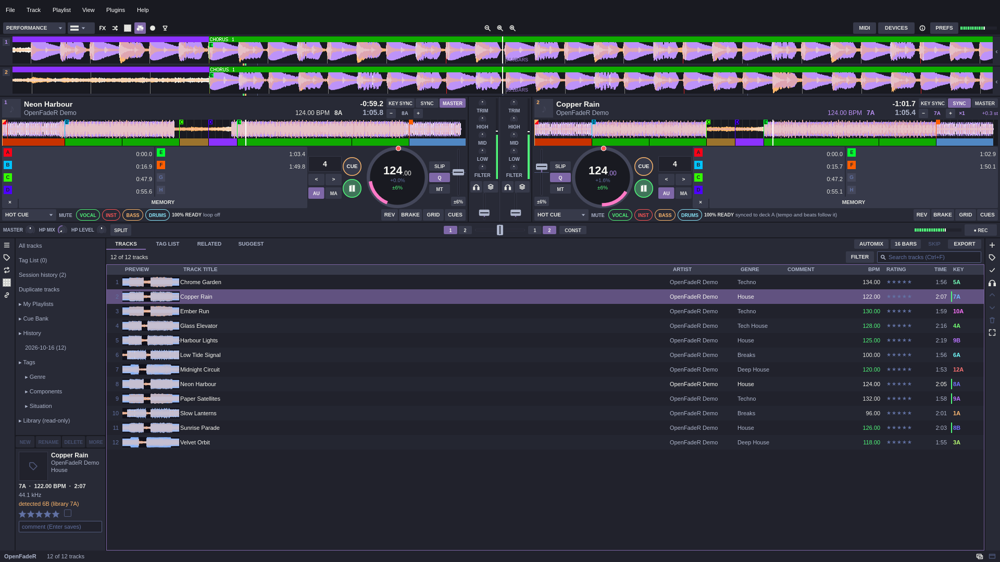

### Nord

Cold polar-night greys with frost blue, after the Nord palette by Arctic Ice Studio. File: `nord.json`.

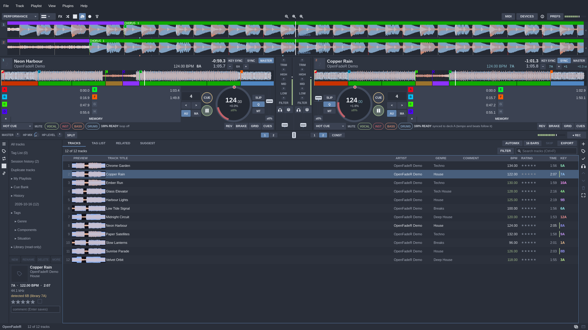

### Gruvbox Dark

Warm retro browns with yellow, orange and aqua, after the Gruvbox palette by Pavel Pertsev. File: `gruvbox-dark.json`.

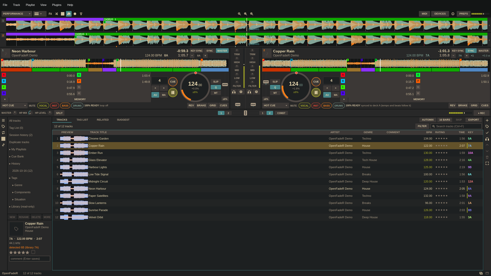

### Tokyo Night

Deep indigo with neon blue, magenta and orange, after the Tokyo Night palette by enkia. File: `tokyo-night.json`.

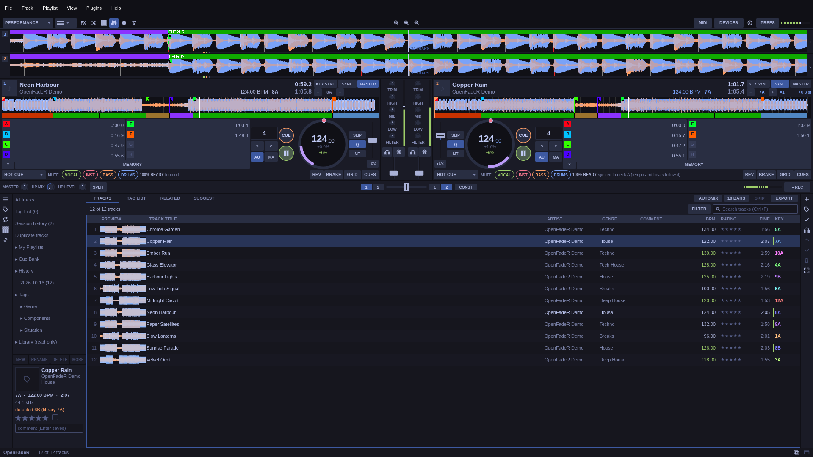

### Ocean and High Contrast

Two small examples that set only a few tokens. They show how little a theme needs: Ocean is cool blues on a near-black window, High Contrast is black and white with a strong blue and cyan. Files: `ocean.json`, `high-contrast.json`.

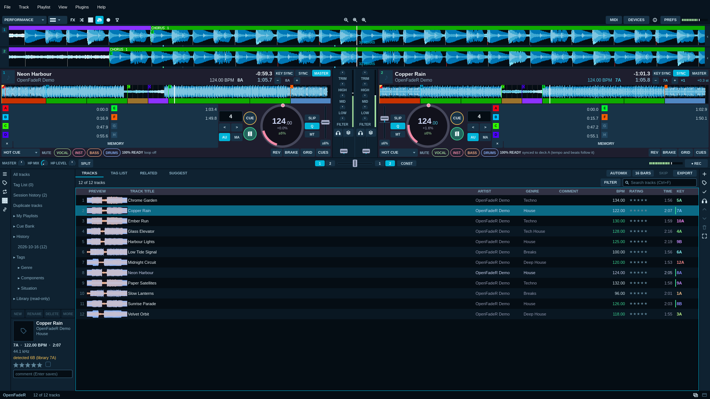

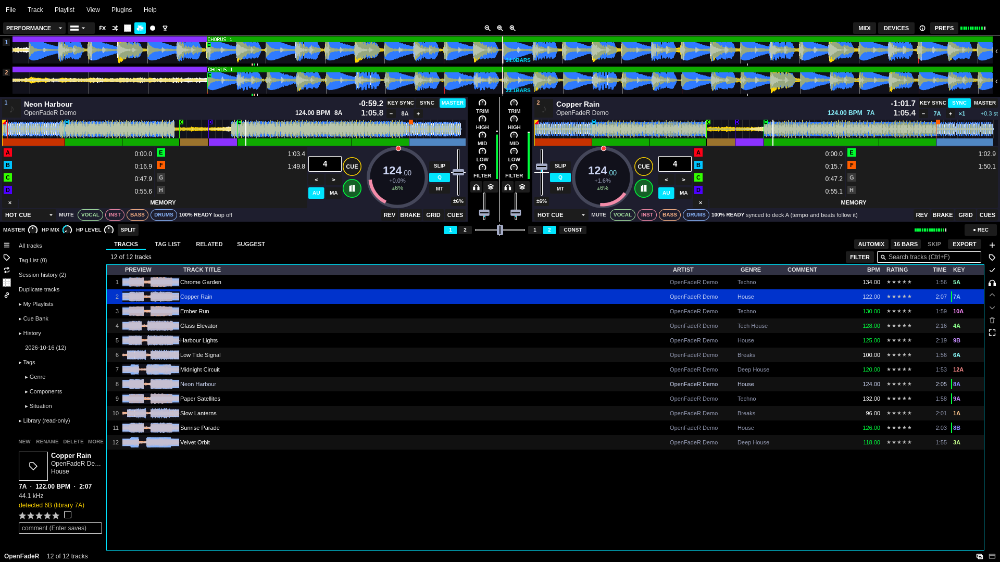

## Make your own

You do not need to write JSON by hand. Apply the theme closest to what you want, then in PREFERENCES > THEMES press CUSTOMIZE. The editor lists every token in groups (surfaces, text, accents, waveform, decks and meters, typography, sizes, motion). Pick colours with a colour picker or type `#rrggbb`, step sizes with `−` and `+`, and watch the whole app change as you go. The app is the preview.

When you like it, press SAVE AS. The theme is written to `~/.config/openfader/extension/skin/<name>.json` with every token and applied at once. RESET restores a single token, RESET ALL goes back to where you started, DUPLICATE copies an existing theme to edit, and IMPORT adds a file.

A theme file is small:

```json
{
  "name": "Ocean",
  "author": "me",
  "description": "Cool blues on a near-black window",
  "base": "dark",
  "layout": { "deck_layout": "vertical", "line_space": "small" },
  "tokens": { "accent": "#00b4d8", "wave-bg": "#050d14", "font-size": 12 }
}
```

Tokens you leave out keep the value of `base` (`dark` or `light`). The full token list, value formats and the layout hints are in the core repository's [docs/skins.md](https://github.com/OpenRsG/OpenFadeR/blob/main/docs/skins.md).

### Share it

Put your `.json` file in a GitHub repository, at the top or at most two folders deep. Anyone can then type its GitHub path (`user/name`) in PREFERENCES > THEMES > GET THEMES, press ADD, and install your themes the same way they install these.

To get a theme into this repository, open an issue first if it is more than a small fix, then a pull request. [CONTRIBUTING.md](CONTRIBUTING.md) shows how to try your change in a core checkout and the test that every theme here must pass (it must load without a note). The [code of conduct](CODE_OF_CONDUCT.md) applies. Security reports go through [SECURITY.md](SECURITY.md).

## Related repositories

[OpenFadeR](https://github.com/OpenRsG/OpenFadeR) is the app. [OpenFadeR-Plugins](https://github.com/OpenRsG/OpenFadeR-Plugins) holds library, device and effect plugins, and [OpenFadeR-Map](https://github.com/OpenRsG/OpenFadeR-Map) the MIDI controller mappings.

## License

AGPL-3.0, see [LICENSE](LICENSE). Made by [OpenRsG](https://github.com/OpenRsG).
